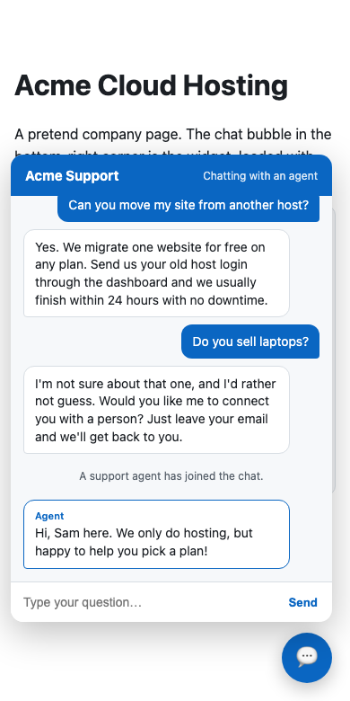
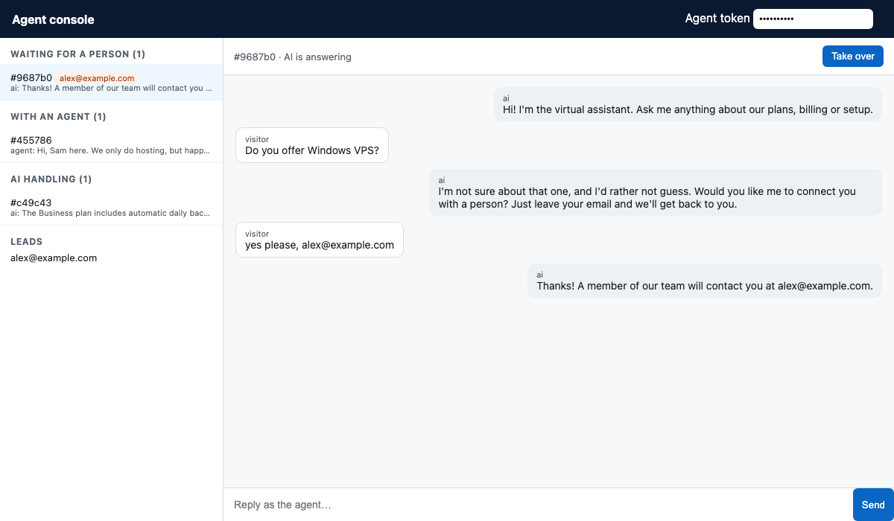

# AI Support Widget 💬

A drop-in **AI customer-support chat** for any website: one `<script>` tag, answers
**stream in token by token**, the bot **hands off to a person instead of guessing**,
and a small **agent console** lets a human take over a live chat and hand it back.

- **Backend:** FastAPI, Server-Sent Events, no database needed for the demo
- **Widget:** plain JavaScript in a Shadow DOM, no framework or build step
- **Runs offline in seconds.** Add an `OPENAI_API_KEY` and it switches to LLM answers grounded in your FAQ.

<p align="center">
  
</p>

> I run a production version of this pattern: a 24/7 AI support widget on a US
> tax-services platform, with SSE streaming, human takeover and lead capture.
> This repo is a clean-room rewrite of the ideas, small enough to read in one
> sitting. It is not the production code. — [Naeem Lashari](https://www.linkedin.com/in/naeem-lashari)

---

## What it does

| | |
|---|---|
| **Streams answers** | Replies arrive token by token over SSE, so the first words show up immediately instead of after a spinner. |
| **Doesn't guess** | Every question goes through retrieval first. If nothing in the knowledge base matches, the bot says so and offers a person. It never lets a model improvise an answer about your prices or policies. |
| **Human takeover** | An agent opens `/agent`, sees who is waiting, clicks **Take over**, and replies. The bot goes quiet until the agent clicks **Hand back to AI**. The visitor sees the agent's messages live. |
| **Captures leads** | If the visitor types an email or phone number, or fills the small form, it is saved against the chat and shown in the console. |
| **Survives reloads** | The chat id is kept in the browser, so a page refresh restores the conversation. |
| **Fails safe** | If the model API errors mid-answer, the visitor gets a clear message and the chat is flagged for a person, never silence. |
| **Basic protection** | Per-IP rate limiting (every message can cost LLM tokens), message length cap, token-protected agent API, CORS allow-list. |

<p align="center">
  
</p>

---

## Quickstart

```bash
git clone https://github.com/lashari/ai-support-widget
cd ai-support-widget
python -m venv .venv && source .venv/bin/activate
pip install -r requirements.txt

AGENT_TOKEN=demo-token uvicorn app.main:app --reload
```

- Open http://127.0.0.1:8000 for the demo page with the chat bubble.
- Open http://127.0.0.1:8000/agent and enter `demo-token` to see chats live and take one over.

Ask it *"How much does hosting cost?"* or *"Can you move my site from another host?"*,
then something it can't know, like *"Do you sell laptops?"*.

### Use a real LLM

```bash
export OPENAI_API_KEY=sk-...
export OPENAI_MODEL=gpt-4o-mini   # default
```

The retrieval gate stays the same. The top FAQ matches go into the prompt as context,
and the model is told to answer only from them.

---

## Put it on your site

```html
<script src="https://support.example.com/static/widget.js"
        data-title="Acme Support"
        data-color="#0A66C2"
        defer></script>
```

Then replace `data/faq.md` with your own content:

```markdown
## How do I reset my password?
> I can't log in to my account
Go to the login page and click "Forgot password"...
```

`## ` lines are questions and the paragraph under each is the answer. `> ` lines are
other ways customers ask the same thing. Adding the words your customers actually use
is the cheapest way to improve answers.

---

## How it works

```
 visitor's browser                         server (FastAPI)
 ─────────────────                         ────────────────
 widget.js ── POST /messages ───────────►  retrieval over data/faq.md
    ▲                                        │
    │                                        ├─ no good match ──► "I'd rather not guess" + offer a person
    │                                        │                    (chat flagged "waiting")
    │                                        └─ match ──► offline: stream the FAQ answer
    │                                                     OpenAI : stream the model's grounded answer
    ◄──────── SSE tokens ────────────────────┘
    ▲
    └── GET /events (SSE) ◄── agent replies, "agent joined", mode changes ◄── /agent console
```

Two SSE channels keep it simple:

1. **The reply to each message** streams back on the `POST` itself. The widget reads it
   with `fetch` and a stream reader, because `EventSource` can't send a body.
2. **A long-lived `EventSource`** carries anything that happens *outside* a reply, like
   an agent's message, with a keep-alive comment every 15 s so proxies don't drop it.

| File | What's in it |
|---|---|
| `app/main.py` | Routes, the answer stream, takeover and lead logic |
| `app/knowledge.py` | FAQ parser and the retriever (IDF-weighted overlap; question and alias words count fully, answer-only words count half) |
| `app/responder.py` | Offline and OpenAI responders behind one interface, plus the grounding gate |
| `app/store.py` | In-memory conversations and a tiny pub/sub for the live feed |
| `app/guards.py` | Lead extraction, token-bucket rate limiter |
| `static/widget.js` | The embeddable widget |
| `static/agent.html` | The agent console |

### API

| Method | Path | |
|---|---|---|
| `POST` | `/api/conversations` | Start a chat |
| `POST` | `/api/conversations/{id}/messages` | Send a message; the reply streams as SSE |
| `GET` | `/api/conversations/{id}/messages` | Transcript (restores a chat after reload) |
| `GET` | `/api/conversations/{id}/events` | Live feed: agent replies, mode changes |
| `POST` | `/api/conversations/{id}/lead` | Lead form |
| `GET` | `/api/agent/conversations` | *Agent:* chats grouped as waiting, human, AI |
| `POST` | `/api/agent/conversations/{id}/takeover`, `/release`, `/reply` | *Agent:* take over, hand back, reply |
| `GET` | `/api/agent/leads` | *Agent:* captured leads |

Agent routes need `Authorization: Bearer $AGENT_TOKEN`. Interactive docs are at `/docs`.

---

## Tests

```bash
pip install -r requirements-dev.txt
pytest -q
```

30 tests, no network needed. They cover retrieval (including a false-positive
regression and off-topic questions that must *not* match), streaming, the handoff
gate, lead capture, takeover and hand-back, rate limiting, the transcript, and the
OpenAI path against a mocked streaming API, including a model failure mid-answer.

---

## Going to production

This demo keeps state in memory so it runs with zero setup. For real traffic:

- **Storage and fan-out.** Move `Store` to Postgres for transcripts and Redis pub/sub for
  the live feed, so you can run more than one worker.
- **Retrieval.** Swap `KnowledgeBase.search()` for vector or hybrid search over your docs.
  See [rag-demo](https://github.com/lashari/rag-demo) for dense + BM25 + RRF. Keep the gate.
- **Agent auth.** Replace the shared token with real agent logins.
- **Proxy.** Turn off response buffering for SSE (`X-Accel-Buffering: no` is already sent
  for nginx) and allow long read timeouts on `/events`.
- **Notifications.** Email or Slack an agent when a chat enters "waiting".

## Limitations

- The offline retriever matches words, not meaning. It handles the FAQ's own wording and
  the `> ` alternate phrasings well, but it will miss paraphrases nobody wrote down.
- Conversations are lost when the server restarts, and the rate limiter is per process.

## License

MIT
